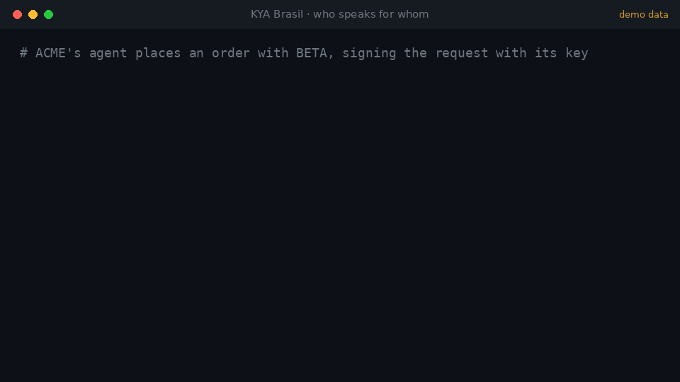

# KYA Brasil

[](https://glama.ai/mcp/servers/celfons/kya-brasil)



**Know-your-agent backed by ICP-Brasil.** Most "KYA" tools prove that an agent holds a key and give it a score.
KYA Brasil answers the question a supplier, a bank or a marketplace actually asks: **who answers for this agent,
and what is it allowed to do?**

A Brazilian **company** signs with its **e-CNPJ**, or a **person** with their **e-CPF**, that an AI agent key acts on
their behalf within a declared **mandate** (actions, amounts, currencies, counterparties, payment instruments,
validity). The issuer validates the ICP-Brasil chain and the certificate's revocation (CRL), checks that the
company is active at the Receita Federal, and re-checks every day. The result is an Ed25519-signed credential:
verifiable offline, live status at a stable URL, revocable at once. Every per-action verdict is signed too.

- **Open source and self-contained.** No closed service, no API key, no contract: Receita open data (BrasilAPI,
  CNPJ.ws, or your own source), each AC's public CRL, the ITI trust anchors in this repository.
- **Three ways to use it.** The hosted service (HTTP and MCP, pay per call with x402), the library
  `@kya-brasil/core` inside your own systems, or your own issuer from this repository.
- **Signing without friction.** A1 `.pfx` in the browser, A3 token or card (PKCS#11 or any ICP-Brasil signer),
  cloud certificates through a provider interface; the agent prepares, a person signs.
- **Privacy by design.** Companies: no CPF or name of the certificate holder. Persons: no name, no CPF, only a
  keyed hash, deleted when the credential ends.

KYA Brasil answers *who speaks for whom*, not *whether they are a good risk*. Sanctions, debt and litigation are
the verifier's call, with whatever screening it trusts.

| | |
| --- | --- |
| Service | `https://kya-br-agents.marcelfons.workers.dev` (landing, `/docs` Swagger, `/status`) |
| MCP (streamable HTTP) | `https://kya-br-agents.marcelfons.workers.dev/mcp`, Registry `io.github.celfons/kya-brasil` |
| npm | [`@kya-brasil/core`](https://www.npmjs.com/package/@kya-brasil/core) (the library), [`@kya-brasil/agent-tools`](https://www.npmjs.com/package/@kya-brasil/agent-tools) (client, middleware, `kya-sign`) |
| Payments | [x402](https://x402.org), USDC on Base, no signup. Free verification up to 50/day per IP. Errors are never charged. |
| Spec | [docs/SPEC.md](docs/SPEC.md), [test vectors](docs/vectors/credential-v1.json), [decisions](docs/DECISOES.md), [examples](examples) |
| License | MIT |

## Why this is different

| | Key-only KYA (DID, score, bonds) | Policy gateways | **KYA Brasil** |
| --- | --- | --- | --- |
| Who answers for the agent | nobody, a key | the agent's operator | **a company (e-CNPJ) or a person (e-CPF), ICP-Brasil** |
| Link kept true | no | no | **certificate revocation and company registration, at issuance and daily** |
| Mandate | no | operator policy | **declared by whoever answers for the agent, shown to them when they sign** |
| Verdict per action | score | allow / deny | **signed allow / deny with every check listed, usable as evidence** |
| Payment instruments | no | no | **card tokens / PARs bound to the mandate, as hashes** |
| Whoever answers sees its agents | no | dashboard | **inventory (and webhooks for companies), signed with their certificate** |
| Verifiable offline, open spec and code | rarely | no | **yes** |

## For verifiers: you receive an action from someone else's agent

```ts
import { createKyaClient, verifyAttestation } from "@kya-brasil/agent-tools";

const kya = createKyaClient();                                    // add { privateKey } for paid calls
const v = await kya.verify(credentialId);                         // free: principal, mandate, live status
if (v.status !== "active") reject();

const verdict = await kya.allowed(credentialId, {                 // $0.01, signed
  action: "order", amount: 4200, currency: "BRL", counterparty: "12345678000190"
});
if (!verdict.allowed) reject(verdict.reason);
await verifyAttestation(verdict);                                 // the issuer's signature, checked locally
```

- Check that the key that signed the agent's request is `v.agent.id` (or `v.agent.wallet` for ERC-8004).
- Check `principal.kind` before reading `principal.cnpj`: `"person"` credentials carry no CNPJ and nothing personal.
- `max_per_day` uses the `spent_today` you pass: the issuer does not record what agents do.
- Offline (issuer unreachable): `verifyCredentialOffline(credential)` checks signature and expiry, with
  `live_status: "unknown"`.

Over MCP: `kya_verify`, `kya_check_action`, `kya_verify_paid`. Claude Desktop, Cursor and others: add the remote
server `https://kya-br-agents.marcelfons.workers.dev/mcp`, no auth.

### Sign in with KYA (one middleware)

The agent signs every request with its key (four `KYA-*` headers); your server verifies it and gets who the agent
is, who answers for it and its mandate. Hono, Express, Workers, Next, Bun, Deno.

```ts
import { createKyaAuth } from "@kya-brasil/agent-tools";
const auth = createKyaAuth();
app.use("/api/*", auth.hono());                                   // or auth.express(), auth.fetchHandler(handler)
app.post("/api/orders", (c) => {
  const kya = c.get("kya");                                       // { credential_id, agent, principal, mandate, check(), allowed() }
  if (!kya.check({ action: "order", amount: 4200, currency: "BRL" }).allowed) return c.json({ error: "outside the mandate" }, 403);
});
```

Agent to agent, both sides verified: `createKyaAgent(...).fetch(url)` and `signResponse`. Profile in
[docs/SPEC.md](docs/SPEC.md) section 14.

### Sub-agents: one certificate signature for the whole tree

When the mandate carries `delegation: { max_depth, max_ttl_seconds }`, the agent hands a narrower mandate to
another key with its own signature, no new e-CNPJ or e-CPF signature. The sub-agent signs its requests with its own
key and sends the chain; your middleware verifies it offline and `check()` / `allowed()` evaluate every mandate in it.

```ts
import { signDelegation, signRequest } from "@kya-brasil/agent-tools";
const chain = await signDelegation({ credential, key: agentKey, delegate: { kind: "web-bot-auth", id: subPublicKey },
  mandate: { actions: ["quote"], max_per_operation: { amount: 500, currency: "BRL" } }, ttlSeconds: 600 });
const headers = await signRequest({ credentialId, key: subKey, delegation: chain, method: "GET", url });
// server side: c.get("kya").delegation → { depth, delegate, mandates, expires_at, chain }
```

Short-lived (at most `max_ttl_seconds`, never past the credential), contained in the parent mandate, at most 3
levels; revoking the credential ends the whole tree. The issuer stores nothing. [docs/SPEC.md](docs/SPEC.md) section 17.

## Give your agent a credential

1. **Register** (`POST /v1/agents`, $0.25, or MCP `kya_register`): the agent key, the mandate, and either the
   company's `cnpj` or `principal: "person"`. Returns a one-time challenge and a `sign_url`.
2. **The agent signs** the challenge with its key and sends `sign_url` + `&agent_signature=…` (also from the free
   `kya_sign_link`) to whoever holds the certificate: the owner or the accountant, or the person themselves.
3. **A person signs** with the certificate, in whichever way fits:

   | Certificate | Browser (`/sign`) | Terminal (`kya-sign`) | Code (`@kya-brasil/core`) |
   | --- | --- | --- | --- |
   | A1 file (`.pfx`/`.p12`) | sign in the page; the file never leaves the computer | `kya-sign --pfx empresa.pfx --link "<url>"` | `openPfx(bytes, password)` |
   | A3 token or card | download the challenge, sign it in your usual signer, upload the `.p7s` | `kya-sign --pkcs11 <vendor library> --link "<url>"` | `ecnpjSigner({ certificates, sign })` |
   | Cloud (PSC) | "Certificado em nuvem" tab on an issuer with a provider configured | `kya-sign --cloud ./my-psc.mjs --link "<url>"` | `cloudSigner(session)` |

   Cloud certificates go through one interface, `CloudSignatureProvider`; no PSC is implemented here because each
   has its own contract ([template](examples/cloud-provider)).
4. **Issued** (`/prove`, free): agent signature, ICP-Brasil chain, CRL, the CNPJ in the certificate (or the e-CPF),
   company ATIVA. Valid 90 days; renew for $0.10; revoke at once, free, signed with the same certificate.

The page shows exactly what is being authorized (agent, company or person, mandate) before anything is signed.
An agent should not hold the certificate to sign for itself: that signature is the consent of whoever answers.

Agent keys: `evm` (EIP-191), `web-bot-auth` (Ed25519, RFC 9421) or `erc8004` (an
[ERC-8004](https://eips.ethereum.org/EIPS/eip-8004) agent whose on-chain wallet signs). Mandate example:

```json
{ "actions": ["quote", "order", "pay"],
  "max_per_operation": { "amount": 5000, "currency": "BRL" }, "max_per_day": { "amount": 20000, "currency": "BRL" },
  "currencies": ["BRL"], "counterparties": ["12345678000190", "*.beta.com.br"],
  "payment_instruments": [{ "network": "visa", "ref_sha256": "9f2c…" }],
  "valid_until": "2027-01-01T00:00:00Z" }
```

**Companies** see every agent in their name and get signed lifecycle events at a webhook
(`kya_company_agents`, `kya_company_webhook`, signed with the e-CNPJ).

## For people: an agent that acts for you

With `principal: "person"` the person signs with their **e-CPF**. The credential publishes nothing personal
(`principal: { kind: "person", verified_by: "icp-brasil-e-cpf" }`). The issuer keeps only an HMAC of the CPF with a
secret key, never the name or the CPF, and deletes it when the credential is revoked or expires.

A verifier that already has the person's CPF asks `POST /v1/agents/{id}/principal-match` ($0.01, signed): it learns
only whether it matches, plus a `subject_ref` of its own for that person, different for every verifier so services
cannot link the person across them. Three wrong answers stop its checks. The person sees every check in their
inventory (`POST /v1/people/agents`, signed with the e-CPF).

## For payment networks, acquirers and issuers

The mandate can list the payment instruments the agent may use: the network and the SHA-256 of a reference the
network already gives (token reference, PAR), never a card number. At authorization time, hash what you received
and ask whether that instrument belongs to an agent authorized within its limits. The signed verdict records the
instrument, the amount and the time: evidence for a later dispute ([examples/evidence](examples/evidence)).

```ts
import { checkAction, hashPaymentRef } from "@kya-brasil/core";
const verdict = checkAction(credential.mandate, {
  action: "buy", amount: 4200, currency: "BRL", payment_network: "visa", payment_ref_sha256: await hashPaymentRef(tokenRef)
});
```

## As a library: no hosted service in the path

`@kya-brasil/core` is the code the issuer runs, as pure functions: e-CNPJ and e-CPF signatures with the ICP-Brasil
chain, CRL revocation, agent signatures, mandate evaluation (payment instruments included), credential build,
signing and verification, holder-side signing (A1, tokens, cloud), and the person hashing. A bank, a network or a
platform can verify credentials from any issuer offline, or issue its own with its own keys, storage and audit.
Storage and network stay yours: see [packages/core/README.md](packages/core/README.md).

## Tools and prices

| Tool | HTTP | USDC |
| --- | --- | --- |
| `kya_verify` | `GET /v1/agents/{id}`, `GET /v1/agents/by-key` | free, 50/day per IP |
| `kya_prove`, `kya_revoke`, `kya_sign_link`, `kya_company_agents`, `kya_company_webhook`, `kya_person_agents` | `POST /v1/agents/{id}/prove`, `/revoke`; `GET /v1/agents/{id}/sign-link`; `POST /v1/companies/{cnpj}/agents`, `/webhook`; `POST /v1/people/agents` | free |
| `kya_verify_paid` | `GET /v1/agents/{id}/verified` | 0.01 |
| `kya_check_action` | `GET /v1/agents/{id}/allowed` | 0.01 |
| `kya_principal_match` | `POST /v1/agents/{id}/principal-match` | 0.01 |
| `kya_renew` | `POST /v1/agents/{id}/renew` | 0.10 |
| `kya_register` | `POST /v1/agents` | 0.25 |

Discovery: `/docs` (Swagger UI), `/llms.txt`, `/openapi.json`, `/server.json`, `/.well-known/kya.json` (signing keys,
active and retired), `/.well-known/kya-mandate.schema.json`, `/.well-known/x402`, `/status`, `/terms`, `/sign`.
Verifier for any signed document: `POST /v1/verify`.

## What a credential looks like

```json
{ "credential_id": "6d0b…", "version": 1,
  "agent": { "kind": "evm", "id": "0x7099…" },
  "principal": { "cnpj": "11222333000181", "cnpj_formatted": "11.222.333/0001-81", "legal_name": "ACME LTDA", "registration_status": "ATIVA" },
  "authorized_by": { "method": "icp-brasil-e-cnpj", "certificate_sha256": "3b7a…", "certificate_subject": "CN=ACME LTDA:11222333000181, …", "issuer": "CN=AC …", "signed_at": "…" },
  "mandate": { "…": "…" }, "kyb_snapshot": null,
  "status": "active", "issued_at": "…", "expires_at": "…",
  "verify_url": "https://kya-br-agents.marcelfons.workers.dev/v1/agents/6d0b…",
  "attestation": { "algorithm": "ed25519", "key_id": "35bb864a2e87c8fd", "sha256": "…", "signed_at": "…", "signature": "…" } }
```

A person's credential has `"principal": { "kind": "person", "verified_by": "icp-brasil-e-cpf" }` and
`"authorized_by": { "method": "icp-brasil-e-cpf", … }` without a subject. The signature covers the credential as
issued; suspension, revocation and expiry are reported live at `verify_url` and `/v1/revocations`.
`registration_status` is `ATIVA`, or `UNVERIFIED` / `NOT_CHECKED` when the Receita sources were down or the check is
off (issued anyway, with a warning: availability never depends on a third party).

## Architecture

```
agent / verifier ──x402 or MCP──▶ kya-br-agents (Cloudflare Worker: Hono HTTP + MCP Durable Object)
                                     │  D1: agents, challenges, events, webhooks, person checks, call log
                                     │  KV: cache, limits, ICP-Brasil anchors, cloud signing state
                                     │  cron 03:17 UTC: certificate CRLs, company registration, person data retention
                                     ├──HTTPS──▶ [CNPJ_API_URL] → BrasilAPI → CNPJ.ws (Receita open data, no key)
                                     └──HTTPS──▶ each AC's CRL (from the certificate)
```

| Path | What |
| --- | --- |
| `packages/core` | npm `@kya-brasil/core`: the library (pure functions, no storage, no platform bindings). |
| `packages/agent-tools` | npm `@kya-brasil/agent-tools`: client with x402, middleware, signing helpers, PKCS#11 tokens, the `kya-sign` command, adapters for OpenAI, Vercel AI, LangChain and Anthropic. |
| `apps/worker` | The issuer: HTTP routes, MCP server, `/sign` page, D1 store and migrations, registration sources, CRL checks, daily review, cloud provider registry. |
| `infra` | Pulumi: KV, D1 + migrations, Worker, cron, secrets. |
| `anchors` | ICP-Brasil trust anchors (PEM) uploaded to KV by the CD. No anchors, no issuance. |
| `examples` | Signed evidence JSONs, the cloud provider template. |
| `docs` | Specification, test vectors, decisions, runbook, self-hosting. |

## Run it

```sh
docker compose up --build                       # whole issuer in a container, http://localhost:8787
pnpm install && pnpm typecheck && pnpm test     # development (CI also runs the A3 path on a SoftHSM2 token)
cd apps/worker && cp .dev.vars.example .dev.vars && pnpm dev
```

Push to `main` deploys `dev` and `prod` from the GitHub environments of the same name (`PULUMI_ACCESS_TOKEN`,
`CLOUDFLARE_API_TOKEN`, `CLOUDFLARE_ACCOUNT_ID`, `PAY_TO`; optional `INTERNAL_API_KEY`, `CDP_API_KEY_ID` /
`CDP_API_KEY_SECRET`, `CNPJ_API_URL`, `REGISTRATION_CHECK`). The CD applies the D1 migrations, generates the
signing key and the person HMAC key once per stack, uploads the anchors, runs the smoke test and rolls back on
failure. [docs/RUNBOOK.md](docs/RUNBOOK.md), [docs/SELF-HOSTING.md](docs/SELF-HOSTING.md).

**Code and service.** The MIT license covers this code. The hosted issuer at `kya-br-agents.marcelfons.workers.dev`
is a service with its own [terms](https://kya-br-agents.marcelfons.workers.dev/terms), and the name KYA Brasil
identifies it; a fork is a different issuer with a different key, and verifiers choose which issuers they trust.

## Contributing and security

Contributions are welcome, in Portuguese or English: [CONTRIBUTING.md](CONTRIBUTING.md),
[CODE_OF_CONDUCT.md](CODE_OF_CONDUCT.md), [SECURITY.md](SECURITY.md) (report vulnerabilities privately). Changes to
the format are changes to the spec first; `/v1` fields are only added, never renamed or removed.
